# Architecture

Session-coordination POC: a Modern.js shell owns identity transitions and injects a framework-neutral `SessionApi` into Module Federation remotes. Remotes keep their own data clients. This is **not** production authentication.

Related: [DI decision](decisions/001-session-di.md) · [limitations](limitations.md) · [AGENTS.md](../AGENTS.md)

## Package map

| Package / app | Role |
| --- | --- |
| `@poc/platform-contracts` | Types + small validators only. No store instances. Remotes depend on this package for session/lifecycle types. |
| `@poc/remote-kit` | Remote-side host kit: `resolveSession`, `createMountHandle`, Rsbuild/MF factories, React/Vue session hooks. Shells must not import it. |
| `@poc/session-coordinator` | Shell-internal Zustand vanilla coordinator + remote registry. Remotes must not import it. |
| `@poc/shell-host` | Shell-internal host kit: remotes catalog, MF/Modern.js config factories, coordinator bootstrap. Remotes must not import it. |
| `@poc/shared-session-store` | DI **C** only — package-level singleton anti-pattern. |
| `@poc/shell-ui` | Shared debug UI: session panel, `RemoteHost`, scenario controls, event log. |
| `@poc/test-support` | Fictional fixtures + `MockApiControls` for deterministic delays/failures. |
| `apps/shell-injected` | DI **A** baseline host (`:8090`). |
| `apps/shell-federated` | DI **B** host (`:8091`); exposes `./session` (`getSessionApi`). |
| `apps/shell-zustand` | DI **C** host (`:8092`); imports shared store. |
| `apps/remote-react` | Rsbuild MF remote (`:5001`); TanStack Query + REST orders. |
| `apps/remote-vue` | Rsbuild MF remote (`:5002`); Apollo Client core + GraphQL summary. |
| `apps/mock-api` | Fictional Express backend (`:4010`); session/REST/GraphQL/`__controls`. |

### Dependency directions

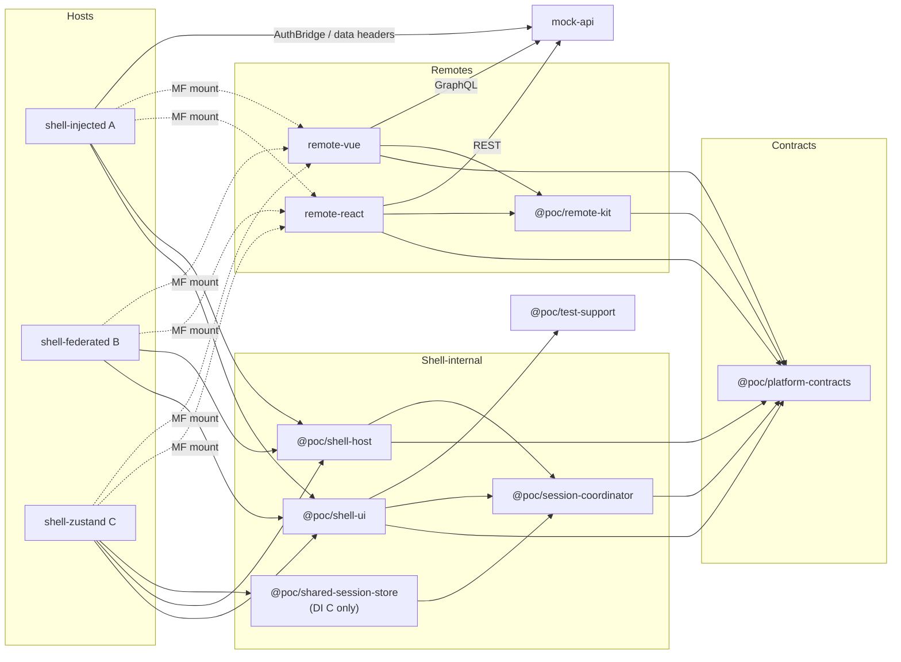

Remotes must not import `@poc/session-coordinator`, `@poc/shell-host`, or shell apps. Their platform dependencies are `@poc/platform-contracts` and `@poc/remote-kit`. Shells must not import `@poc/remote-kit`.

## Ownership diagram

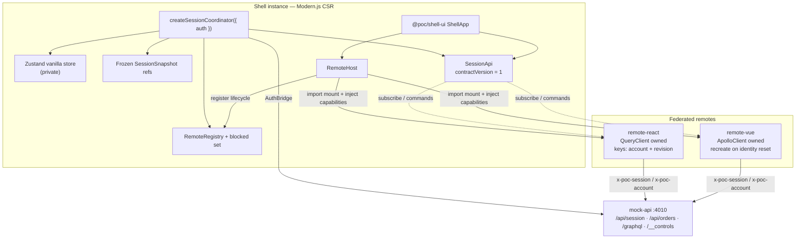

ASCII sketch (same boundaries):

```
┌──────────────────────────────────────────────────────────────────────┐
│ Shell instance (Modern.js CSR)                                       │
│  shell-host · coordinator · registry · SessionApi · shell-ui         │
│   ┌─────────────────────────┐   ┌─────────────────────────┐          │
│   │ remote-react            │   │ remote-vue              │          │
│   │ QueryClient (owned)     │   │ ApolloClient (owned)    │          │
│   └─────────────────────────┘   └─────────────────────────┘          │
└──────────────────────────────────────────────────────────────────────┘
                    │ x-poc-session / x-poc-account
                    ▼
         mock-api :4010 (fictional scope enforcement)
```

### Ownership rules

- **Exactly one coordinator per browser shell instance.** Constructed in the shell app; not shared via browser globals as the primary DI path.
- **Domain data stays in remote-owned caches.** Do not mirror full API responses into a universal Zustand store.
- **Instance identity**
  - **A:** shell constructs API → passes `session` at mount.
  - **B:** same shell-owned API; remotes receive `resolveSession: () => getSessionApi()` (host also exposes federated `./session` for comparison).
  - **C:** package singleton — intentional coupling demo only.

### DI styles at a glance

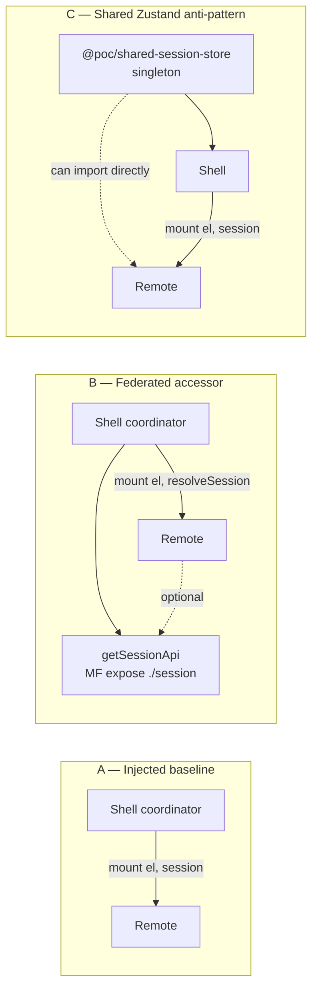

See [001-session-di.md](decisions/001-session-di.md) for tradeoffs. **A** is the baseline; **C** is intentionally wrong for production.

## Public session contract

```ts
type SessionStatus =
  | "initializing"
  | "authenticated"
  | "anonymous"
  | "transitioning"
  | "error";

type SessionSnapshot = {
  status: SessionStatus;
  subjectId?: string;
  accountId?: string;
  contextRevision: number;
};

interface SessionApi {
  readonly contractVersion: 1;
  getSnapshot(): Readonly<SessionSnapshot>;
  subscribe(onChange: () => void): () => void;
  requestLogin(): Promise<void>;
  requestLogout(): Promise<void>;
  requestAccountChange(accountId: string): Promise<void>;
}
```

Invariants:

- Snapshot object identity is stable until state actually changes (frozen refs).
- `contractVersion` (API shape) is independent of `contextRevision` (obsolete-work marker).
- Commands resolve when the new snapshot is published; reject with `SessionCommandError` on failure, timeout, or supersession (`TRANSITION_SUPERSEDED`).
- Never expose raw Zustand stores, `setState`, tokens, or query clients through this API.
- External inputs (e.g. `accountId`) are validated at the coordinator boundary (`assertAccountId`).

`subscribe` / `getSnapshot` alone are **not** proof that remote cleanup completed. Cleanup is a separate lifecycle protocol.

### Session status state machine

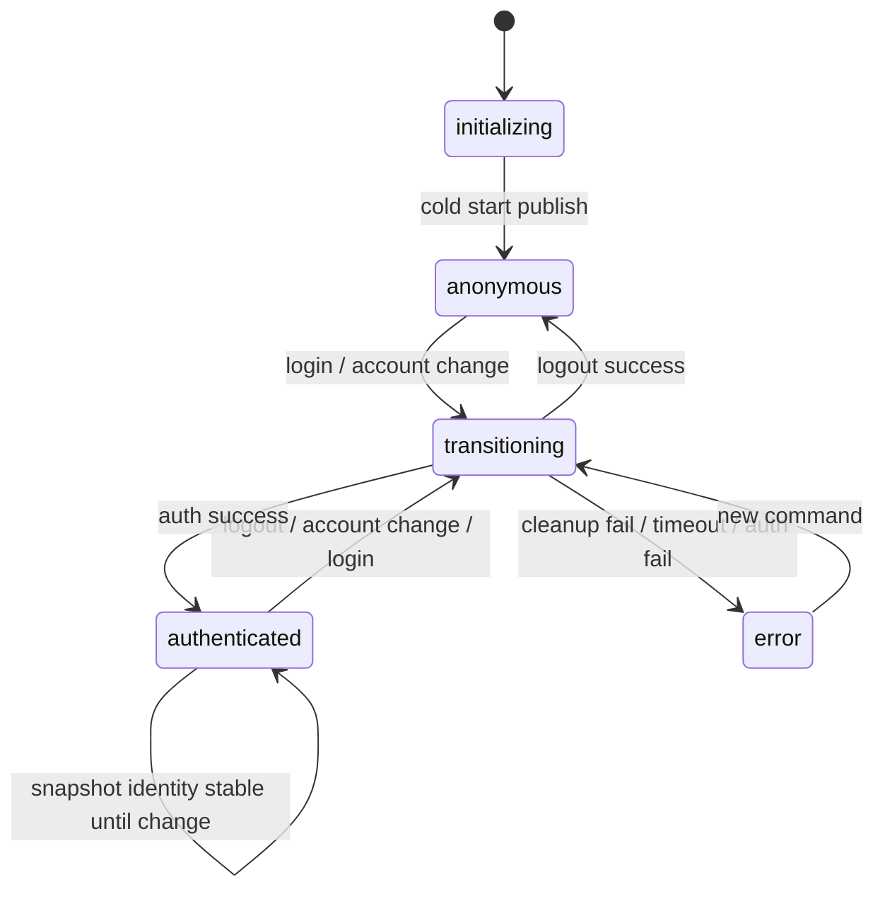

`contextRevision` increments on every transition entry (`transitioning`), including paths that later land in `error`.

## Mount and lifecycle contract

```ts
mount(element, {
  session?,            // DI A / C
  resolveSession?,     // DI B (preferred at mount even when ./session is exposed)
  forceCleanupFail?,   // POC scenario hook
  onEvent?,            // shell diagnostics sink
}): MountHandle // { lifecycle, unmount }

interface RemoteLifecycle {
  prepareTransition(ctx: TransitionContext): Promise<void>;
  resetIdentityState(ctx: TransitionContext): Promise<void>;
  resume(ctx: TransitionContext): Promise<void>;
  block(reason: RemoteBlockReason): void;
  dispose(): void;
}

type TransitionContext = {
  fromRevision: number;
  toRevision: number;
  signal: AbortSignal;
};
```

Resolution order inside remotes: `capabilities.session ?? capabilities.resolveSession?.()`.

### Mount / registry sequence

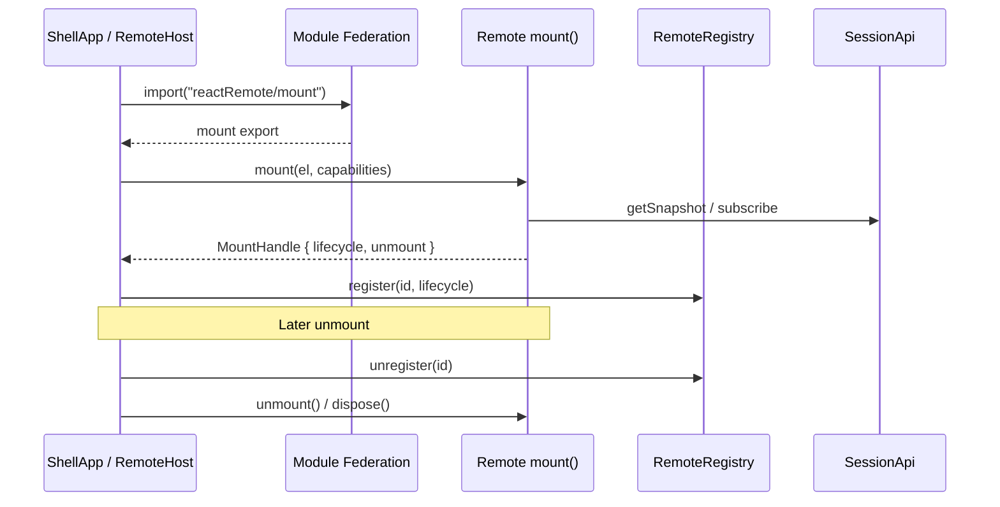

### Registry behavior

1. `RemoteHost` dynamically imports the federated `./mount` export.
2. On success: `registry.register(id, handle.lifecycle)`.
3. On unmount/dispose: `registry.unregister(id)` then `handle.unmount()` / `lifecycle.dispose()`.
4. Late mount during `transitioning`: remote may register and observe the transitioning snapshot; it stays gated until `resume` or `block`.
5. Blocked remotes are skipped for subsequent prepare/reset/resume until remount clears the blocked set via re-register.

### Module Federation wiring

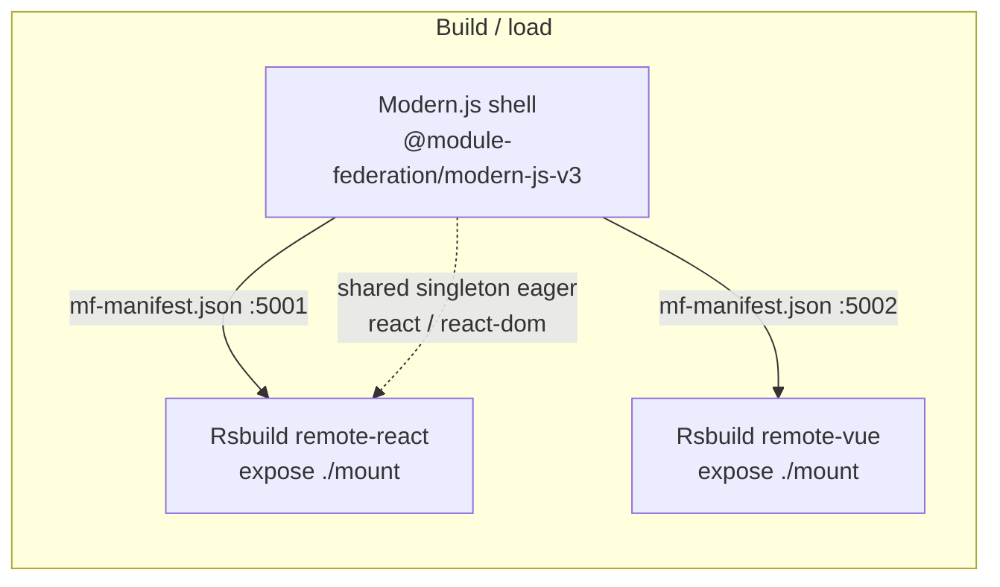

- Remotes: Rsbuild + `@module-federation/rsbuild-plugin`, expose `./mount`.
- Shells: Modern.js v3 + `@module-federation/modern-js-v3`, consume remotes via `mf-manifest.json`.
- Host shares `react` / `react-dom` as **singleton + eager** so the React remote does not mount with an undefined shared scope.
- Vue is shared from the Vue remote; the shell does not need to own Vue.

## Session transition sequence

Implemented order in `@poc/session-coordinator` (single-flight `withTransition`):

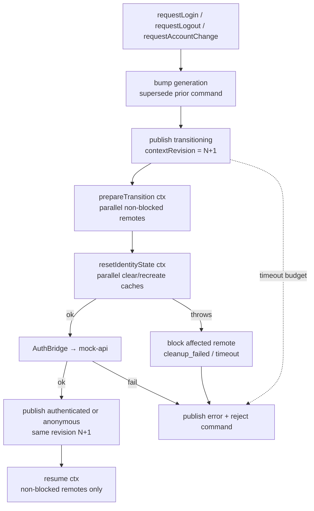

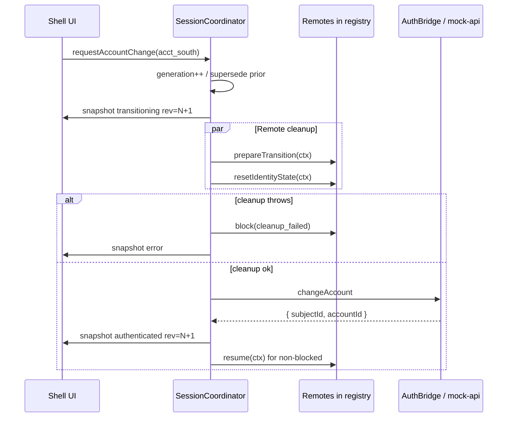

Notes on this ordering:

- Revision advances **before** remote cleanup so in-flight responses can detect obsolescence immediately.
- Remotes reset **before** auth confirmation so old-account cache contents cannot remain visible while waiting on mock-api. If auth then fails, the shell publishes `error` at the new revision rather than resuming old data.
- Default transition budget: `transitionTimeoutMs` (3000ms). Timeout aborts the signal, blocks remaining remotes with `timeout`, publishes `error`, and rejects the command.
- Competing commands: only the latest generation wins; superseded callers reject with `TRANSITION_SUPERSEDED`.
- Remote lifecycle phases are serialized across transitions via an internal promise chain so prepare/reset/resume from different generations do not interleave unsafely.

### Competing commands

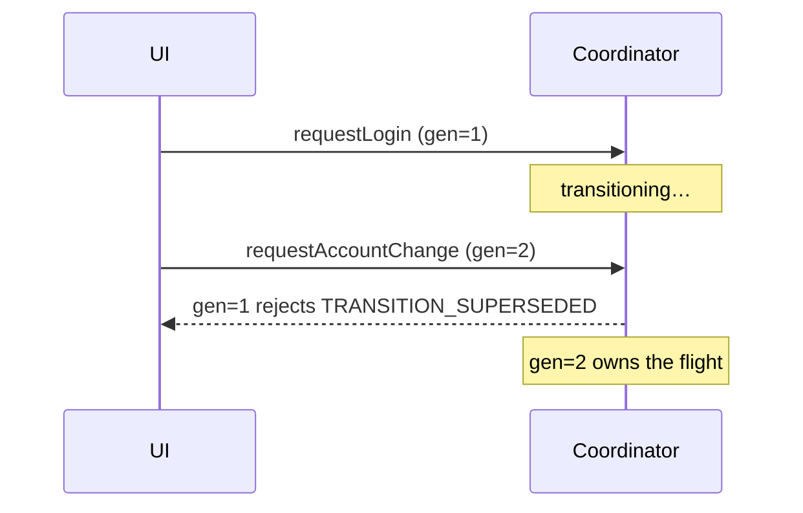

### Fail-closed policy

| Failure | Behavior |
| --- | --- |
| `resetIdentityState` throws | That remote is `block({ type: "cleanup_failed" })`; command fails; no resume with old data |
| Transition timeout | Non-blocked remotes blocked as `timeout`; snapshot → `error` |
| Auth bridge / other failure | Snapshot → `error` at the transition revision; command rejects |
| Supersession | Prior command rejects; winner continues |

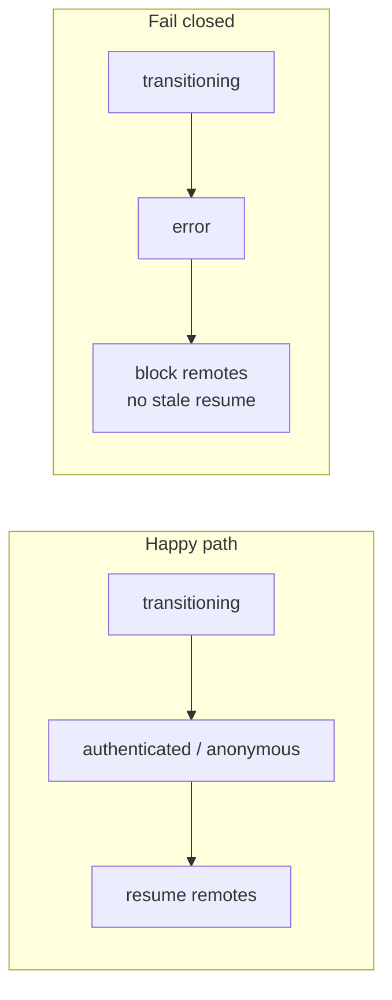

## Auth bridge and mock-api

The coordinator depends on an injected `AuthBridge`, not on Express directly:

```ts
type AuthBridge = {
  login(): Promise<{ subjectId: string; accountId: string }>;
  logout(): Promise<void>;
  changeAccount(accountId: string): Promise<{ subjectId: string; accountId: string }>;
};
```

Shell A/B use `@poc/shell-host` `createCoordinatorHost()` / `createMockAuthBridge()` → `POST /api/session/{login,logout,account}`.

Fictional identities:

| subjectId | accountId |
| --- | --- |
| `user_ava` | `acct_north` |
| `user_beau` | `acct_south` |

Account switch maps to the owning subject (each account has one fictional owner).

### Request-scope data path

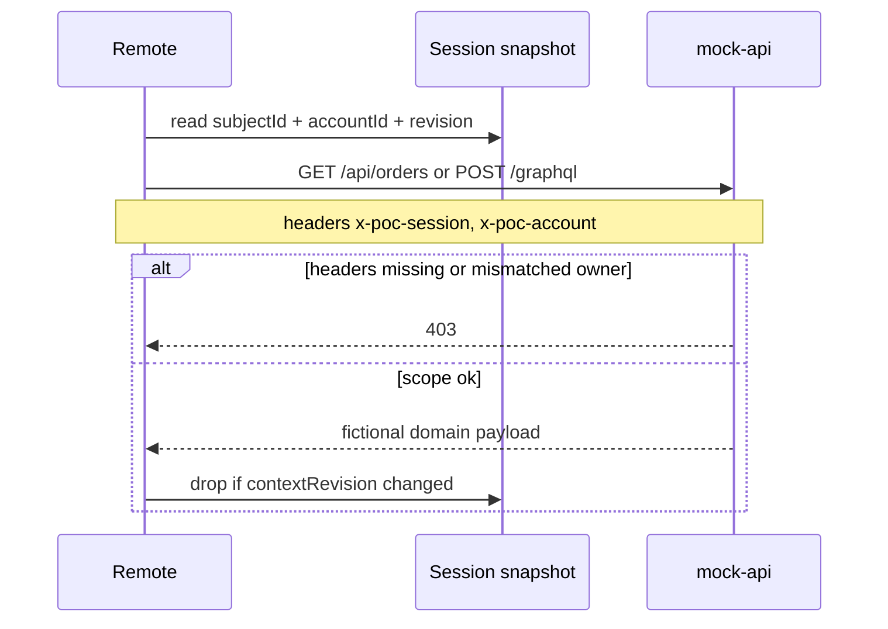

Data routes (`/api/orders`, `/graphql`) require matching `x-poc-session` + `x-poc-account` headers and reject cross-account access with HTTP 403. Client-sent account id alone is **not** authorization — the POC only demonstrates request-scope checks.

`/__controls` provides deterministic delay, fail-next, and cleanup-fail toggles for tests/UI scenarios (also applied to session routes so transition failures are reproducible).

## Remote data-client decisions

### React + TanStack Query

- One `QueryClient` per mount; cleared on identity reset / block / dispose.
- Query keys include `accountId` + `contextRevision`.
- Fetch uses `AbortSignal` where supported and re-checks snapshot revision before committing UI data.
- Session subscription via `useSyncExternalStore`.
- Local feature state (draft note) resets on identity reset/block.

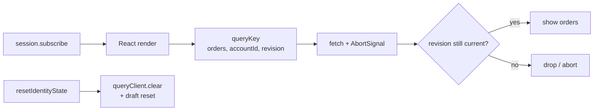

### Vue + Apollo Client core

- Framework-neutral `@apollo/client` (no React Apollo).
- On `resetIdentityState`, **recreate** `ApolloClient` + `InMemoryCache` bound to the new identity headers.
- Why not `clearStore` / `resetStore` alone: clearing cache does not reliably cancel or isolate in-flight network/response races tied to the previous client instance; a new client+cache makes old observers unreachable.
- Results captured under an obsolete `contextRevision` are dropped in the view layer.
- Local draft state resets with identity.

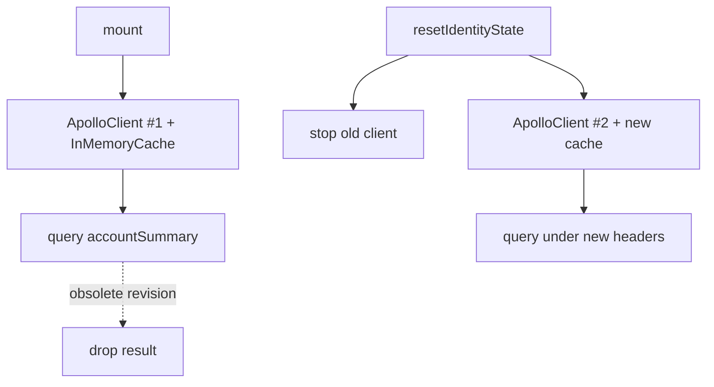

### Mutation / invalidation policy

- Transitions do **not** wait for in-flight mutations.
- A mutation accepted by the server may complete under the original revision.
- Never auto-retry an old-account mutation under a new account.
- Domain invalidation hints (when present) are refresh signals only — not authoritative records; late-mounted remotes must fetch current data.

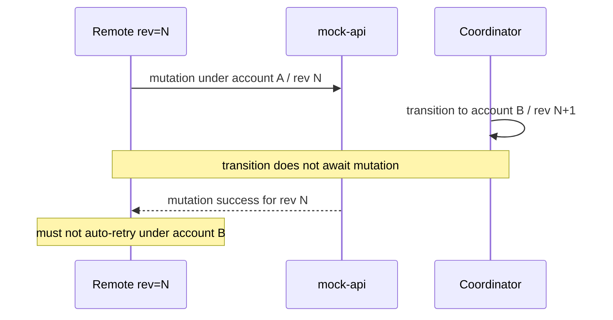

## Shell UI composition

Each shell renders `@poc/shell-ui` `ShellApp` with a `remotes` list from `@poc/shell-host` (`bindMount` plus a host-local `import("<mfName>/mount")`):

- DI mode label + optional banner (required for C)
- Session status, fictional user/account, context revision, contract version
- Login / logout / account switch
- Per-remote mount/unmount toggles derived from the list
- Scenario controls (delay, fail-next, force cleanup failure)
- Bounded event/debug log (no credentials)

`forceCleanupFail` is closed over at mount time; toggling it remounts remotes so the next transition observes the flag.

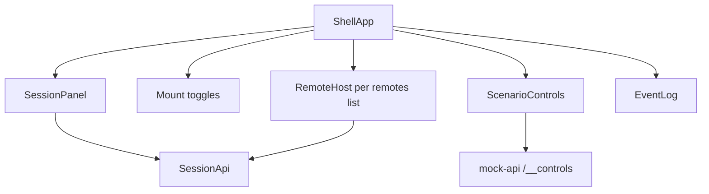

## Runtime topology

| Process | Default URL |
| --- | --- |
| mock-api | `http://127.0.0.1:4010` |
| remote-react | `http://127.0.0.1:5001` |
| remote-vue | `http://127.0.0.1:5002` |
| shell-injected (A) | `http://localhost:8090` |
| shell-federated (B) | `http://localhost:8091` |
| shell-zustand (C) | `http://localhost:8092` |

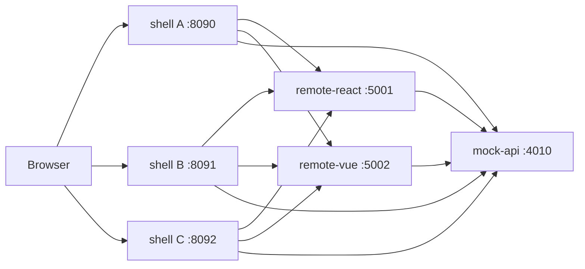

Shells use 809x because some developer machines bind proxies on 8080; if Modern.js falls back from a busy configured port while asset URLs still target the original port, the UI breaks.

Start stack: `pnpm dev:poc` (mock-api + both remotes + shell A).

## Same-realm security limitations

All Module Federation remotes share the page JavaScript realm. `SessionApi` is a capability object for coordination, **not** a sandbox or trust boundary. Malicious remote code can still observe memory and network in this POC. Production multi-team remotes need additional isolation/review beyond this architecture.

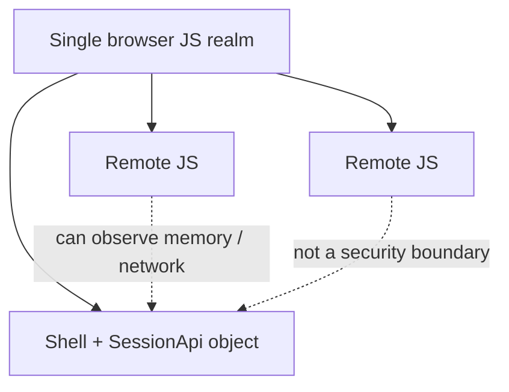

## Intentionally excluded

- Production IdP integration / real token refresh
- Request-scoped SSR session state (would be required for production SSR)
- Native / WebView adapters
- Cross-origin iframe messaging
- Cross-tab session synchronization
- Organization-wide migration tooling / full design system
